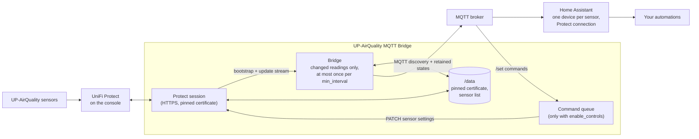

# UP-AirQuality MQTT Bridge app for Home Assistant

[](LICENSE)


A Home Assistant app that brings UniFi Protect UP-AirQuality sensors into Home Assistant through MQTT discovery: every reading as a sensor, vape detection and safe zones as binary sensors, optionally the LED ring and alert thresholds as controls. It follows Protect's update stream instead of polling and sends each reading only when it changed.

Requires Home Assistant 2026.11 or later.

## Overview



The [documentation](upaq_mqtt/DOCS.md) covers the options, the certificate check, the entities, example automations and troubleshooting. Changes are listed in the [changelog](upaq_mqtt/CHANGELOG.md).

## Installation

1. Add the repository to your Home Assistant instance:

   [](https://my.home-assistant.io/redirect/supervisor_add_addon_repository/?repository_url=https%3A%2F%2Fgithub.com%2Fn-schilling%2Fha-app-upaq-mqtt)

   Or add it manually: **Settings → Apps → Install app → ⋮ → Repositories**, then paste:

   ```text
   https://github.com/n-schilling/ha-app-upaq-mqtt
   ```

2. Install **UP-AirQuality MQTT Bridge**, fill in the options and start it.

## Development

The bridge is a Python package in [`upaq_mqtt/rootfs/usr/lib/upaq_bridge`](upaq_mqtt/rootfs/usr/lib/upaq_bridge). `scripts/check.sh` runs what CI runs: the changelog check, shellcheck, ruff, the tests (with a Mosquitto broker in Docker, plain and with TLS), the image build and its start without options. It needs [uv](https://docs.astral.sh/uv/) and Docker:

```bash
scripts/check.sh
```

The image's Python packages are pinned with their hashes in `upaq_mqtt/requirements.txt`. After changing the direct dependencies in `upaq_mqtt/requirements.in`, regenerate it:

```bash
cd upaq_mqtt && uv pip compile requirements.in --universal --python-version 3.14 --generate-hashes --no-annotate -o requirements.txt
```

Releases: work on `dev`, raise `version` in `upaq_mqtt/config.yaml` and add its section to the changelog; once `main` is green, the release workflow tags the version and publishes the release with that section.

## Support

Questions, bugs and ideas: [open an issue](https://github.com/n-schilling/ha-app-upaq-mqtt/issues/new/choose) in this repository. Security problems: see [SECURITY.md](SECURITY.md).

## License

[Apache License 2.0](LICENSE)
