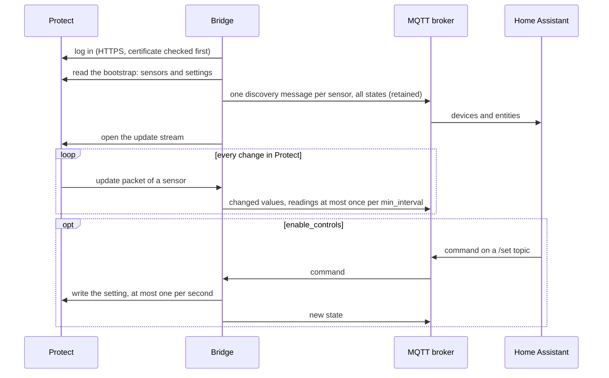
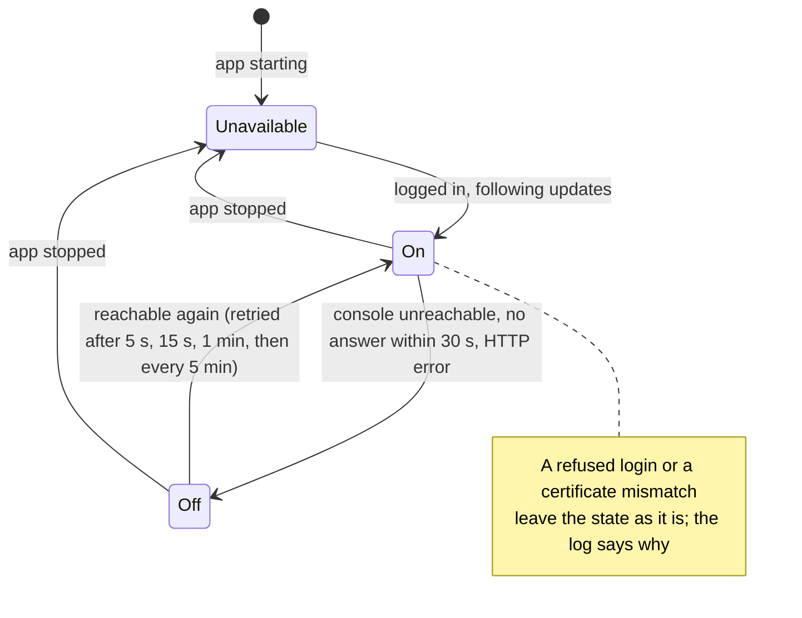

# UP-AirQuality MQTT Bridge

Follows the UP-AirQuality sensors in UniFi Protect and brings their readings into Home Assistant through MQTT discovery: one device per sensor, one entity per reading the sensor reports (AQI, CO2, PM1.0 to PM10, TVOC, VOC and NOx index, vape index, and temperature and humidity where reported). Optionally it also controls the LED ring and the alert thresholds.

The bridge keeps one connection to Protect open and receives every change as it happens; it does not poll.



## Requirements

- A UniFi console running Protect with at least one UP-AirQuality sensor
- A local Protect user for the bridge: in UniFi OS, **Admins & Users → Create New**, *Restrict to local access only*, role *View Only* for Protect. Only `enable_controls` needs a role that may change device settings (see *Security* below)
- An MQTT broker, e.g. the Mosquitto broker app with the MQTT integration

## Options

| Option | Default | Meaning |
|---|---|---|
| `protect_host` | | Host name or IP address of the console running Protect, e.g. `192.168.1.1`; `https://192.168.1.1/` or `192.168.1.1:8443` work too |
| `protect_username` | | Local Protect user |
| `protect_password` | | Its password |
| `certificate_check` | `pin` | How the console's certificate is checked: `pin`, `accept_any` or `public_ca` (see below) |
| `certificate_fingerprint` | | Optional: the SHA-256 fingerprint to pin, instead of the one seen first |
| `enable_controls` | `false` | Create LED and threshold controls; the Protect user then needs write access |
| `min_interval` | `60` | Seconds between two published values of one reading; `0` publishes every change |
| `discovery_prefix` | `homeassistant` | MQTT discovery prefix |
| `mqtt_host`, `mqtt_port`, `mqtt_username`, `mqtt_password` | | Only for a broker the Supervisor does not know; shown with *Show unused optional configuration options* |
| `mqtt_tls` | `false` | With `mqtt_host`: connect with TLS (see *Security*); `mqtt_port` then defaults to `8883` |
| `mqtt_ca` | | With TLS: file name of the CA certificate (PEM) the broker's certificate must chain to, in Home Assistant's `ssl` folder, e.g. `mqtt-ca.pem`; empty trusts public CAs |
| `log_level` | `info` | How much the app writes to its log: `info`, `warning` or `error` |

### The console's certificate

UniFi consoles use a self-signed certificate. The connection is always encrypted; `certificate_check` decides how the bridge makes sure it talks to your console and not to someone in between, who would then receive the Protect password.

| `certificate_check` | Accepts | Protects the password against a man in the middle |
|---|---|---|
| `pin` (default) | The certificate seen at the first connection, and from then on only that one | Yes, from the first connection on |
| `accept_any` | Any certificate, also self-signed or expired | No |
| `public_ca` | A certificate from a public CA (e.g. Let's Encrypt) for the name in `protect_host`; not with an IP address | Yes |

With `pin` the bridge keeps the fingerprint in its private data and writes it to the log as a warning at the first start:

> Pinned the console's certificate on first use: 3F:A1:…

Compare it once with the fingerprint your browser shows for the console's page (certificate details, SHA-256). Only then do you know that nobody was in between at that first connection. To pin a known fingerprint from the start, set `certificate_fingerprint`; a fingerprint set there is always the one pinned, whatever `certificate_check` says.

**When the console gets a new certificate** (rare; e.g. after a reset or a new domain), the app stops without sending the password, and its log says:

> Certificate mismatch, configured fingerprint: 3F:A1:… found fingerprint: 7B:0E:…

Check that the change is expected, e.g. in your browser on the console's page, then copy the found fingerprint into `certificate_fingerprint` and start the app. Only admins can change the app's options, so nobody else can make the bridge trust another certificate.

`verify_ssl` of versions before 2.4.0 is still understood: `true` means `public_ca`.

### Why not plain HTTP

UniFi consoles answer plain HTTP only with a redirect to HTTPS, for the login and the Protect API alike, so the bridge always uses HTTPS. It follows no redirects, so the password goes to the console and nowhere else.

### Security

- **The Protect user.** *View Only* is enough for all readings, vape detection and safe zones. `enable_controls` needs a role that may change device settings in Protect; UniFi OS offers *Full Management* for that, which also covers cameras, recordings and users. Turn `enable_controls` on only if you need the controls, and keep the user restricted to local access.
- **Who can send commands.** With `enable_controls` the bridge takes commands from the MQTT topics `up_airquality/+/+/set`, `up_airquality/+/thresh/+/+/set` and `up_airquality/+/events/+/set`. MQTT does not say who sent a message: anybody who may write to these topics on the broker can change the sensors' settings, e.g. switch off *Events to Capture* for vape. With the Mosquitto broker app that is every Home Assistant user and every app using MQTT. If that matters to you, limit write access to `up_airquality/#` to Home Assistant's own MQTT user with the broker's ACLs. The bridge checks every command against the sensor and the allowed range, ignores retained commands, writes at most one per second to Protect and keeps at most 64 waiting.
- **The broker connection.** With the Mosquitto broker app the connection stays inside Home Assistant's internal network. If the Supervisor reports the broker with TLS, the bridge uses TLS and checks the broker's certificate and name. A broker set with `mqtt_host` is reached without TLS unless you turn on `mqtt_tls`; without it, its user, password, the readings and the commands cross your network in clear text. With `mqtt_tls` the broker's certificate must name the host in `mqtt_host` (the name or IP address, as the certificate lists it) and chain to a public CA or, with `mqtt_ca`, to your own CA: put its certificate (PEM, not the key) into Home Assistant's `ssl` folder, e.g. with the File editor or Samba app, and enter its file name. Only that CA is trusted then. The app reads the `ssl` folder and cannot change it.



## Sensors

Per sensor, named after the sensor in Protect:

| Entity | Meaning |
|---|---|
| AQI, CO2, PM1.0, PM2.5, PM4.0, PM10, TVOC Index, VOC Index, NOx Index, Vape Index, … | Readings; the `status` attribute holds Protect's rating (e.g. `good`, `moderate`) |
| Vape Detected | On when Protect rates the vape index anything but `safe` |
| *Reading* Outside Safe Zone | Only for readings with a safe zone set in Protect (*Add Safe Zone* under *Events to Capture*); on while the reading is below or above it, at once and regardless of `min_interval`. The attributes hold the zone. Read access is enough, so the zones you keep in UniFi drive your automations |
| Firmware Version | Installed firmware (diagnostic) |
| Firmware Update Available | On when Protect offers newer firmware (diagnostic) |

A sensor's entities turn unavailable when it disconnects from Protect, when Protect is out of reach, or when the bridge stops. A reading you switch off under *Events to Capture* in Protect turns unknown, and so do its *Outside Safe Zone* and, for vape, *Vape Detected*; switched on again, the value is back at once. Readings are retained, so they are back right after a restart of Home Assistant. Entities that go away (a safe zone deleted, controls switched off, a sensor removed from Protect) are removed from Home Assistant together with their retained states.

The bridge's own device *UP-AirQuality MQTT Bridge* has *Protect connection*: on while the bridge is logged in to Protect and follows its updates, off only while Protect cannot be reached (network error, no answer within 30 seconds, HTTP error), unavailable while the app is stopped. Starting or stopping the app, a refused login or a certificate mismatch do not turn it off; Protect answered in those cases, the log says why the bridge does not use it.

The devices link to the app under **Settings → Apps**.

### Controls

Only with `enable_controls`:

| Entity | Meaning |
|---|---|
| LED Brightness, LED Metric, Status Light, Night Mode, Night Mode Brightness | The sensor's LED ring and status light |
| *Reading* Events | The *Events to Capture* switch of a reading in Protect |
| Vape Sensitivity | Protect's vape sensitivity in % |
| *Reading* Low / High Threshold | For every reading the sensor offers alert thresholds for; disabled by default, enable the ones you need. Their ranges are the measurement ranges of Ubiquiti's data sheet; TVOC is not in it and gets a wide range |

Commands go to Protect one after another, at most one per second; a newer value for the same control replaces one still waiting.

## Example automations

Notify when the CO2 level stays above 1200 ppm for ten minutes:

```yaml
triggers:
  - trigger: numeric_state
    entity_id: sensor.living_room_co2
    above: 1200
    for: "00:10:00"
actions:
  - action: notify.notify
    data:
      message: "CO2 in the living room is {{ states('sensor.living_room_co2') }} ppm, time to air the room."
```

Notify when vaping is detected in a room:

```yaml
triggers:
  - trigger: state
    entity_id: binary_sensor.kids_room_vape_detected
    to: "on"
actions:
  - action: notify.notify
    data:
      message: "Vaping detected in the kids' room."
```

Air the room while CO2 is outside the safe zone you set in UniFi:

```yaml
triggers:
  - trigger: state
    entity_id: binary_sensor.living_room_co2_outside_safe_zone
    to: "on"
    for: "00:05:00"
actions:
  - action: notify.notify
    data:
      message: "CO2 in the living room is outside its safe zone: {{ states('sensor.living_room_co2') }} ppm."
```

Warn when the bridge has not been connected to Protect for ten minutes:

```yaml
triggers:
  - trigger: state
    entity_id: binary_sensor.up_airquality_mqtt_bridge_protect_connection
    not_to: "on"
    for: "00:10:00"
actions:
  - action: notify.notify
    data:
      message: "The UP-AirQuality bridge has no connection to Protect."
```

The entity IDs follow the sensor names in Protect; adjust them to yours.

## Troubleshooting

- **"login refused"**: user or password is wrong, or the user is not a local user. Cloud (UI account) users with two-factor authentication cannot log in.
- **"Certificate mismatch"**: see *When the console gets a new certificate* above.
- **"no trusted CA vouches for the console's certificate"**: `public_ca` needs a certificate from a public CA; choose `pin` for the console's own certificate.
- **"public_ca needs protect_host to be the name"**: a certificate names the console, not its IP address; enter the name or choose `pin`.
- **"login failed with HTTP 301"** (or another 3xx): `protect_host` points to something that redirects, e.g. another port or path; enter the console's own address.
- **"did not answer … within 30 s"**: the console accepts connections but Protect is busy, e.g. during an update. The bridge tries again on its own.
- **"CERTIFICATE_VERIFY_FAILED"** in the MQTT log lines: with `mqtt_tls` the broker's certificate is not signed by `mqtt_ca` (or a public CA), or it does not name the host in `mqtt_host`. **"mqtt_ca … not found"**: the file is not in Home Assistant's `ssl` folder; enter the file name only.
- **"Could not save the pinned certificate"**: the app's data folder is full or read-only. The bridge keeps working with the pin in memory but pins again at the next start.
- **No entities**: the log lists the sensors found at every start. Check that the MQTT integration is set up and uses the discovery prefix of the app.
- **Values change only once a minute**: that is `min_interval`; set it lower, at the cost of a bigger recorder database.
- **Controls do nothing**: the Protect user needs write access; the log shows each change and any error.
- **The app stopped**: it stops on purpose only after a certificate mismatch; lost connections to Protect or the broker are retried on their own. To have it started again after any other unexpected end, turn on *Watchdog* on the app's page under **Settings → Apps**. With the watchdog on, a certificate mismatch makes the Supervisor start the app a few more times; each start stops again before the password is sent.

## Known limitations

- Uses the private API of the Protect application, which Ubiquiti may change with a Protect update.
- A UniFi console with several Protect instances is not supported.
- Readings arrive about once a second; `min_interval` thins them out per reading, so a short spike between two publications may not show up.

## Removing the app

The entities are announced with retained MQTT messages and stay in Home Assistant after the app is removed. Delete the sensors' devices under **Settings → Devices & services → MQTT**; Home Assistant then removes the retained messages as well. Sensors you remove from Protect while the app runs are removed from Home Assistant when the bridge next reads Protect's sensor list.

## Support

Questions, bugs and ideas: open an issue at https://github.com/n-schilling/ha-app-upaq-mqtt/issues. Please add the app version and the app log.
